<div align="center">

# Owl

### VPN watchdog: brings the tunnel up, then kills it clean the moment it drops.

A small Python supervisor for OpenVPN that enforces one rule — no half-open state. It launches the VPN, waits for the interface to come up, and keeps watching it; if the tunnel disappears it tears the connection down and exits so nothing is left running in a broken state.


</div>

<div align="center">

</div>

---

<div align="center">

</div>

## Overview

Owl removes a common operational mistake: assuming the VPN is up when it has silently died. It starts OpenVPN in its own terminal, waits for the tunnel interface to appear, and from that point acts as a watchdog. It keeps polling the interface, and if the VPN drops it immediately shuts OpenVPN down and exits — so you never sit in a false sense of safety with a dead tunnel.

The interface check accepts both standard OpenVPN (`tun*`) and ProtonVPN (`proton*`) interfaces.

---

## Core Features

- Starts the OpenVPN connection automatically, in its own terminal window
- Waits up to 30 seconds for the tunnel to come up before giving up
- Detects both `tun*` and `proton*` interfaces
- Actively monitors the link and tears OpenVPN down the moment it drops
- Stops cleanly on Ctrl+C (`killall openvpn`)
- Auto-elevates with `sudo` when not run as root
- No additional user input required once running

---

## Requirements

| Component | Notes |
|---|---|
| Python 3.x | Interpreter |
| OpenVPN | VPN client |
| GNOME Terminal | The VPN opens in its own window |
| Linux + root / sudo | Required to bring up and tear down the tunnel |

### Expected files

These must exist in your home directory:

| File | Purpose |
|---|---|
| `~/proton.ovpn` | VPN configuration file |
| `~/proton_pass.txt` | VPN username / password file |

---

## Installation

```bash
git clone https://github.com/osmnabyram/Siber-Owl.git
cd Siber-Owl
chmod +x Owl.py
sudo python3 Owl.py
```

On execution Owl brings up OpenVPN, waits for the interface to appear, prints the connection status, and keeps monitoring the link until it drops or you exit with Ctrl+C.

---

## Responsible Use

Owl is a privacy and lab automation tool intended for **educational, lab, CTF, and authorized** use. Use it in line with local law and the terms of the services involved. The author accepts no responsibility for misuse.
